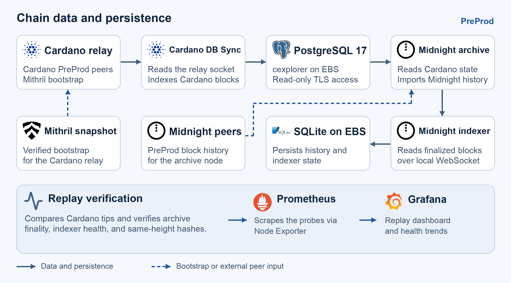
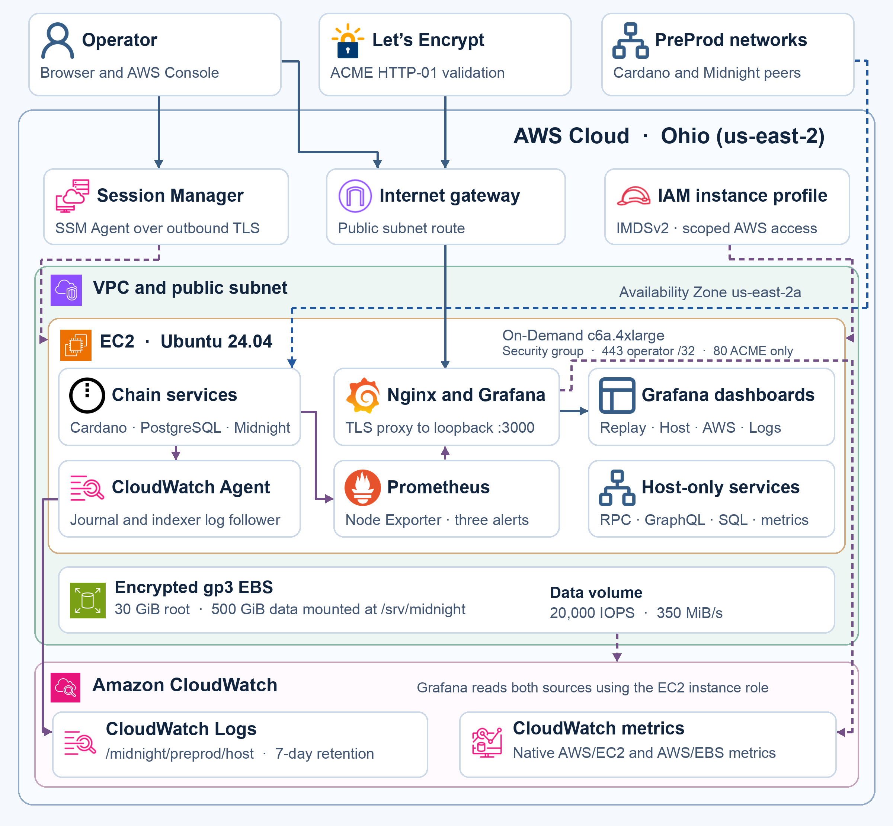
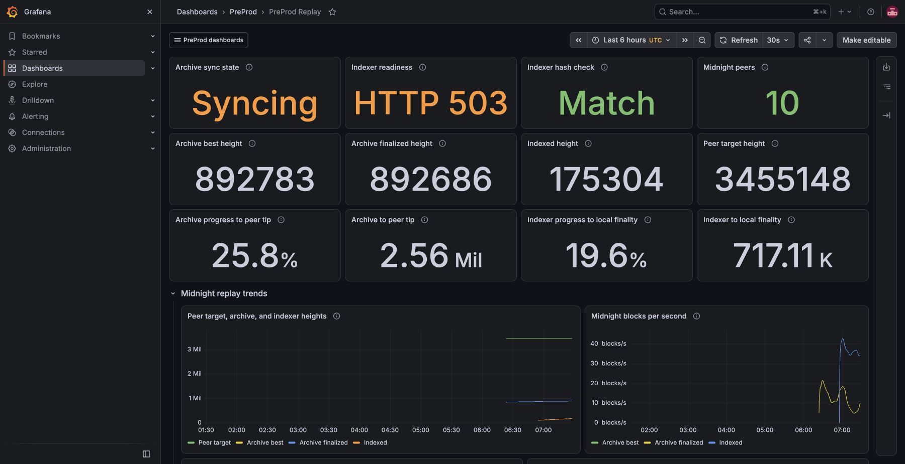

# Midnight PreProd DevOps take-home

A single On-Demand EC2 host in AWS Ohio runs Cardano PreProd, Cardano DB Sync, PostgreSQL, the Midnight PreProd archive, and its standalone indexer. The lab simulates Founding Node Operator onboarding using the public PreProd network. Validator registration and production signing require network-operator access.

## Assessment at a glance

| Section | What was delivered | Evidence |
|---|---|---|
| 1. PreProd onboarding | Cardano DB Sync caught up first. The Midnight archive and standalone indexer then advanced through history with timestamped height and hash checks. | [Deployment runbook](RUNBOOK.md) |
| 2. Monitoring and alerts | Prometheus and Node Exporter collect chain and host metrics. Three tested alert rules and four Grafana dashboards cover replay, host resources, AWS metrics, and service logs. | [Monitoring configuration](monitoring/README.md) · [Grafana dashboards](#grafana-dashboards) |
| 3. Scripting, Option C | A Python health checker polls Midnight RPC at a configurable interval, writes JSON, and reports regressions and recoveries against the previous observation. | [Script and tests](scripts/README.md) |
| 4. Key management | A written plan covers operator key custody, HSM and KMS support, Secrets Manager trade-offs, rotation, and the first three actions after suspected compromise. | [Security plan](SECURITY.md) |
| 5. Terraform and CI | Terraform provisioned the live EC2 lab. A separate stack outline includes Preview, PreProd, and Mainnet inputs, startup dependencies, and mock plan tests. | [Infrastructure guide](infra/README.md) · [Passing CI run](https://github.com/ahmedtariq01/midnight-task/actions/runs/44038869277) |

The [setup and verification commands](commans/) show the paths used to deploy and check the lab. The [prompt history](prompts/) records selected original requests, outputs, and decisions.

## PreProd data flow

Cardano DB Sync writes to PostgreSQL from the Cardano relay's Unix socket. The Midnight archive queries the database over TLS and imports blocks from PreProd peers. The indexer reads local finalized history over WebSocket and writes its index to SQLite. Read-only probes compare heights and hashes across services.

[Cardano brand assets](https://cardano.org/brand-assets/) · [Midnight Brand Hub](https://midnight.network/brand-hub)

## AWS architecture

The lab runs in a public subnet in `us-east-2a` with an encrypted 500 GiB gp3 data volume. Session Manager provides shell access. An operator IPv4 allowlist protects the Nginx HTTPS endpoint for Grafana. Service APIs, databases, and monitoring backends use loopback.

Grafana reads Prometheus for local metrics and CloudWatch for native EC2 and EBS metrics and selected service logs. The EC2 instance role supplies CloudWatch access. The agent ships selected journal events to a seven-day log group. [EC2 configuration](infra/ec2/README.md) · [Grafana and CloudWatch setup](monitoring/grafana/README.md) · [AWS architecture icons](https://aws.amazon.com/architecture/icons/)

## Grafana dashboards

*Captured during PreProd replay on 17 November 2026. The hash check compares the indexer with the archive at the same height.*

| Dashboard | What to look for | Provisioned definition |
|---|---|---|
| **PreProd Replay** | Best, finalized, indexed, and target heights. Replay rate, backlog drain, hash agreement, readiness, and Cardano DB Sync freshness. | [Replay JSON](monitoring/grafana/dashboards/preprod-replay.json) |
| **PreProd Host and EBS** | Linux CPU and I/O wait, memory pressure, filesystem capacity, NVMe latency and queue depth. | [Host and EBS JSON](monitoring/grafana/dashboards/preprod-host-ebs.json) |
| **PreProd AWS EC2 and EBS** | Native CloudWatch CPU, status checks, network traffic, volume I/O and queue depth, and published limit-check datapoints. | [AWS EC2 and EBS JSON](monitoring/grafana/dashboards/preprod-aws.json) |
| **PreProd Service Logs** | CloudWatch Logs Insights warning and error keyword trends and up to 100 recent collected events. | [Service Logs JSON](monitoring/grafana/dashboards/preprod-service-logs.json) |

Operators can open all four from the **PreProd** folder over the allowlisted HTTPS endpoint. The [Grafana guide](monitoring/grafana/README.md) covers provisioning, data sources, and verification.

### Prometheus alerts

| Alert | Why it matters | Operator response |
|---|---|---|
| Block import stalls | The process can stay up while block import stops. | Compare local height with the public tip, then inspect the journal, disk pressure, and peers. |
| Peer count stays low | Fewer peers reduce the paths available to receive new blocks. | Check bootnodes, DNS, outbound peer connectivity, and peer churn. |
| Metrics become unavailable | A failed scrape or missing telemetry removes visibility into the node. | Check the service, loopback metrics endpoint, and Prometheus target in Session Manager. |

All three rules evaluated successfully on EC2. Their firing and recovery behaviour is covered by [Prometheus rule tests](monitoring/alerts.test.yml).

## Verification and scope

- **Cardano** matched the relay's block height and hash at **5,422,294** in the 07:20 UTC check on 17 November 2026.
- **Midnight** was still replaying at **07:25 UTC**. The archive finalized **889,989** against a peer target of **3,455,124**. The indexer had reached **169,970** and returned HTTP `200` on `/live` and `503` on `/ready`. The archive and indexer hashes each matched public PreProd at their sampled heights.
- **Observability** was tested with real Prometheus metrics, native CloudWatch EC2 and EBS datapoints, and a Logs Insights panel that returned 100 collected events. The two volume-level exceeded-check metrics returned no datapoints in the verification window.

The [runbook records the timestamped samples and hashes](RUNBOOK.md#repeat-replay-and-public-hash-check).

## CI and submission evidence

CI passed Terraform validation, lint, security checks, mock plan tests, Prometheus rule tests, and health checker tests. Terraform provisioned the live EC2 lab from its own root. The CloudWatch log group and scoped role policy were created separately and are documented for later Terraform import. The reusable stack workflow's approval-gated AWS apply was skipped. [Live Terraform state notes](infra/ec2/README.md#deployment-and-terraform-review) · [Workflow](.github/workflows/terraform.yml) · [Passing run](https://github.com/ahmedtariq01/midnight-task/actions/runs/44038869277)

## Assumptions and trade-offs

One host and an On-Demand instance kept the assessment deployment simple and allowed both chains to keep working through the replay window. The indexer started during archive replay after historical RPC checks. Its readiness is relative to the local archive. The Terraform outline documents the stricter startup dependencies for a new environment.

## What I would do with more time

Rehearse restoring a verified DB Sync backup and measuring restart-to-tip time. Run monitoring from a second host so an EC2 outage can still trigger an alert. Test an isolated signer and its key-rotation and recovery procedures before registering a validator. [Production and recovery notes](infra/README.md#rebuild-and-production-changes)

## References

| Area | Documentation |
|---|---|
| Cardano relay and DB Sync | [Cardano node setup](https://docs.midnight.network/nodes/cardano-node) · [DB Sync setup](https://docs.midnight.network/nodes/cardano-db-sync) · [Mithril bootstrap](https://mithril.network/doc/manual/getting-started/bootstrap-cardano-node/) · [DB Sync release and snapshot compatibility](https://github.com/IntersectMBO/cardano-db-sync/releases/tag/13.7.1.0) · [PostgreSQL TLS](https://www.postgresql.org/docs/17/ssl-tcp.html) |
| Midnight and indexer | [Full node setup](https://docs.midnight.network/nodes/full-node) · [PreProd network settings](https://docs.midnight.network/relnotes/network#preprod) · [Archive node release](https://github.com/midnightntwrk/midnight-node/releases/tag/node-2.1.101) · [Indexer release](https://github.com/midnightntwrk/midnight-indexer/releases/tag/v4.4.101) · [Indexer GraphQL API](https://github.com/midnightntwrk/midnight-indexer/blob/v4.4.101/docs/api/v4/api-documentation.md) |
| AWS access and storage | [EC2 instance types in Ohio](https://docs.aws.amazon.com/ec2/latest/instancetypes/ec2-instance-regions.html#instance-types-us-east-2) · [Session Manager prerequisites](https://docs.aws.amazon.com/systems-manager/latest/userguide/session-manager-prerequisites.html) · [Map EBS volumes to NVMe devices](https://docs.aws.amazon.com/ebs/latest/userguide/identify-nvme-ebs-device.html) |
| Monitoring | [Prometheus rule tests](https://prometheus.io/docs/prometheus/latest/configuration/unit_testing_rules/) · [Grafana provisioning](https://grafana.com/docs/grafana/latest/administration/provisioning/) · [Grafana CloudWatch data source](https://grafana.com/docs/grafana/latest/datasources/aws-cloudwatch/configure/) · [EBS CloudWatch metrics](https://docs.aws.amazon.com/ebs/latest/userguide/using_cloudwatch_ebs.html) · [CloudWatch Logs Insights](https://docs.aws.amazon.com/AmazonCloudWatch/latest/logs/AnalyzingLogData.html) |
| Key custody | [Midnight signature schemes](https://docs.midnight.network/nodes#signature-schemes) · [AWS KMS algorithms](https://docs.aws.amazon.com/kms/latest/developerguide/kms-cryptography.html) · [CloudHSM signing](https://docs.aws.amazon.com/cloudhsm/latest/userguide/key_mgmt_util-sign.html) · [Secrets Manager encryption](https://docs.aws.amazon.com/secretsmanager/latest/userguide/security-encryption.html) |
| Infrastructure and CI | [Terraform S3 backend and state locking](https://developer.hashicorp.com/terraform/language/backend/s3) · [GitHub deployment environments](https://docs.github.com/en/actions/how-tos/deploy/configure-and-manage-deployments/manage-environments) · [GitHub Actions OIDC](https://docs.github.com/en/actions/reference/security/oidc#immutable-subject-claims) |
