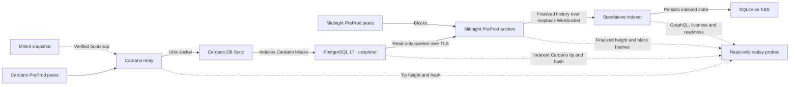
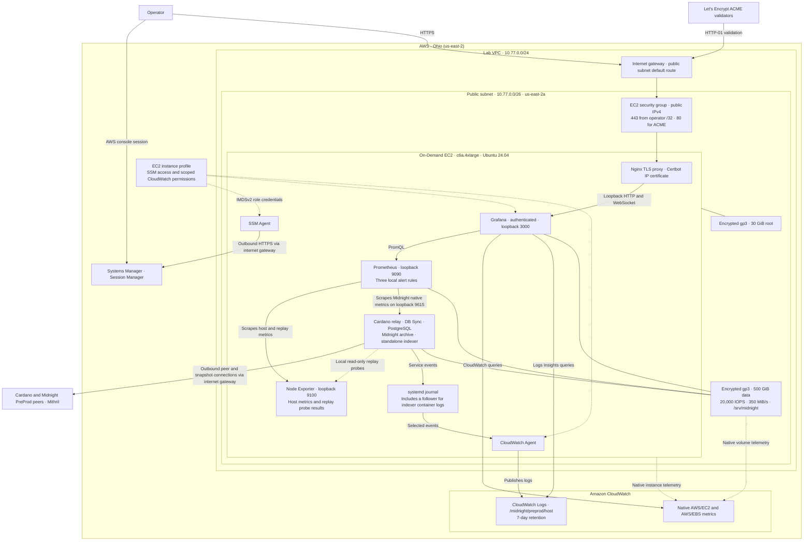

# Midnight PreProd DevOps take-home

This project runs the Cardano dependencies, Midnight PreProd archive node, standalone indexer, and Prometheus on a single On-Demand EC2 instance in Ohio. The lab exercises validator onboarding operations using a public archive node. Validator registration on PreProd requires operator access from the network team.

| Component | Version | Evidence |
|---|---|---|
| Cardano relay | `11.0.1` | PreProd relay tracked the live tip. |
| Cardano DB Sync and PostgreSQL | `13.7.1.0` and `17` | Two PostgreSQL heights and hashes matched the Cardano relay after the near-tip migrations. |
| Midnight archive node | `2.1.101` | At 07:20 UTC on 17 November it had finalized 886,272 blocks and was still replaying. An earlier finalized hash at 885,489 matched public PreProd. |
| Midnight standalone indexer | `4.4.101` | At 07:20 UTC it had indexed 161,119 blocks and its hash matched the archive at that height. `/live` returned `200` and `/ready` returned `503` during replay. |

The [runbook](RUNBOOK.md) records the bootstrap, database TLS setup, and timestamped verification. The [infrastructure guide](infra/README.md) documents the network, storage, Terraform outline, and CI. The [security notes](SECURITY.md) cover operator key custody, rotation, and incident response.

## PreProd data flow

Cardano DB Sync has to reach the Cardano relay tip before the Midnight archive starts. The indexer then reads the archive's finalized history and follows new finalized blocks. The replay probes compare heights and hashes across the local services.



## AWS architecture

The workload runs on one On-Demand EC2 instance in Ohio. The operator reaches the shell through Session Manager and Grafana through Nginx on the instance's public IPv4 address. The security group limits HTTPS to the operator's IPv4 address. The HTTP listener serves ACME certificate validation only.



PostgreSQL, Midnight RPC, the indexer's GraphQL API, and the monitoring backends are reachable only on the host. The EC2 instance role supplies Grafana's CloudWatch read access and the agent's log publishing permissions. See the [EC2 configuration](infra/ec2/README.md) and [Grafana guide](monitoring/grafana/README.md).

## Monitoring

The Prometheus configuration targets the node on `127.0.0.1:9615`. The [monitoring guide](monitoring/README.md) explains the alert durations and checks. The alert choices reflect what an engineer can investigate directly on this host.

On EC2, the Prometheus target reported `up=1` and all three alert rules had evaluation health `ok`. The offline rules test also exercises firing and recovery.

The [Grafana setup](monitoring/grafana/README.md) provides four dashboards over HTTPS from the operator network. **PreProd Replay** shows block progress, readiness, and hash agreement. **PreProd Host and EBS** uses Prometheus for host and disk pressure. **PreProd AWS EC2 and EBS** adds native CloudWatch infrastructure metrics. **PreProd Service Logs** brings the collected CloudWatch service events into Grafana.

| Signal | Why it matters | Operator response |
|---|---|---|
| Block height stops advancing | The process can remain up while it stops importing blocks. | Check best and finalized heights, peers, node logs, and whether Cardano DB Sync is current. |
| Peer count stays low | A node with few peers has fewer routes to receive and validate new blocks. | Inspect bootnode connectivity, DNS, TCP `30333` egress, and peer churn. |
| Metrics scrape is unavailable | Node failure and metrics failure both remove monitoring visibility. | Check the systemd unit, restart history, and loopback metrics endpoint in Session Manager. |

```bash
promtool check config monitoring/prometheus.yml
promtool test rules monitoring/alerts.test.yml
```

## Health checker

Option C polls the node RPC, writes a structured report, and compares it with the previous observation. See the [health checker guide](scripts/README.md) for options and report fields. The RPC is bound to loopback, so run a live check on the EC2 host through Session Manager.

Two live health samples reported expected sync progress. The second reported no active issues and a 487-block increase in best height.

```bash
python3 scripts/node_health.py --rpc-url http://127.0.0.1:9944 \
  --interval 30 --output var/midnight-health.json
python3 -m unittest discover -s scripts -p 'test_*.py' -v
```

## CI and submission evidence

The [GitHub Actions workflow](.github/workflows/terraform.yml) checks formatting, validation, lint, security controls, Terraform assertions, Prometheus rules, and the health checker. PR validation uses the mocked PreProd plan shown in the Actions summary. The AWS apply path uses an approval-protected `preprod` environment and OIDC once the repository owner configures them.

The [passing GitHub Actions run](https://github.com/ahmedtariq01/midnight-task/actions/runs/44030108980) records the mocked PreProd plan, Terraform checks, Prometheus rule tests, and health checker tests. The deployment job was skipped. The runbook records live progression and same-height hashes. Full PreProd verification remains in progress while the archive and indexer replay.

## What I would do with more time

Test restoration from snapshots on a fresh host and measure how long each service takes to resume. Move operator signing to a separate host and monitor the deployment from a second machine so an EC2 outage can still trigger an alert. See the [infrastructure guide](infra/README.md#rebuild-and-production-changes).
