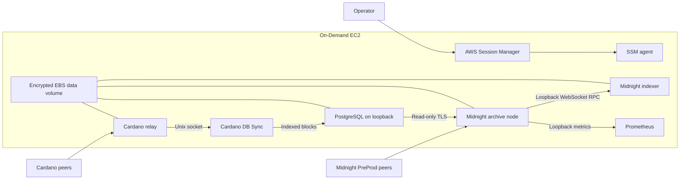

# Infrastructure

The live lab uses the [EC2 Terraform root](ec2/README.md) and [manual bootstrap](../RUNBOOK.md). The [reusable stack outline](stack/README.md) models a new environment with its own state. The two roots have independent lifecycles.



The security group permits outbound traffic for peer connections, downloads, and Session Manager. PostgreSQL `5432`, Midnight RPC `9944`, metrics `9615`, and indexer GraphQL `8088` are local services. The live host uses a separate mounted EBS volume for persistent data. It connects to public PreProd peers and establishes operator access through Session Manager.

## Local verification

Use Terraform `1.14.0`, TFLint `0.64.0`, and Checkov `3.4.5`. The Terraform mock provider exercises the resource model and produces PreProd plan output without credentials. Run the commands from the repository root.

```bash
terraform -chdir=infra/stack fmt -check -recursive
terraform -chdir=infra/stack init -backend=false -input=false -lockfile=readonly
terraform -chdir=infra/stack validate
tflint --chdir=infra/stack --recursive
checkov --directory infra/stack --framework terraform \
  --check CKV_AWS_3,CKV_AWS_8,CKV_AWS_24,CKV_AWS_25,CKV_AWS_79 --compact
terraform -chdir=infra/stack test -no-color -verbose \
  -var-file=environments/preprod.tfvars.example
```

The scanner gates EBS encryption, root disk encryption, unsecured SSH and RDP ingress, and IMDSv2. Terraform tests exercise the lab's private port and storage expectations. The environment examples set Preview, PreProd, and Mainnet inputs for the network and host capacity. Review the [stack guide](stack/README.md) for the variable names, example sizing, and the startup readiness dependencies.

## Remote state and GitHub Actions

For a real outline deployment, use a separate, versioned S3 backend with encryption, public access blocked, and native lockfile support. Scope CI access to the state key and its `.tflock` object. The provider lock file pins downloaded provider binaries. Keep state and saved plans local to the authorized backend or runner.

The merge workflow can apply the outline on `main` after the `preprod` environment review. Configure the environment with required reviewers and a `main` deployment branch rule. Set `AWS_ROLE_ARN`, `TF_STATE_BUCKET`, and `TF_STATE_KEY` on that environment. Match the AWS role trust to the repository's actual OIDC subject and audience `sts.amazonaws.com`. For this repository, use the immutable environment subject format `repo:ahmedtariq01@OWNER-ID/midnight-task@REPO-ID:environment:preprod` and confirm both IDs and the emitted subject. Enable the merge apply path with the repository variable `ENABLE_PREPROD_APPLY=true` after the reviewer rule and AWS trust are in place. GitHub plan and repository visibility affect reviewer-rule availability. [GitHub environments](https://docs.github.com/en/actions/how-tos/deploy/configure-and-manage-deployments/manage-environments) · [GitHub immutable OIDC subjects](https://docs.github.com/en/actions/reference/security/oidc#immutable-subject-claims) · [Terraform S3 backend](https://developer.hashicorp.com/terraform/language/backend/s3)

## Rebuild and production changes

For a timed rebuild, restore a compatible, verified Cardano DB Sync database and ledger-state backup and resume from a recent Cardano point. Record the network, DB Sync release, schema, matching ledger state, checkpoint height, checksums, and restore-test results. Mithril supplies certified relay blocks. PostgreSQL still needs its own database and ledger-state recovery procedure. [Mithril bootstrap](https://mithril.network/doc/manual/getting-started/bootstrap-cardano-node/) · [DB Sync releases and snapshot compatibility](https://github.com/IntersectMBO/cardano-db-sync/releases/tag/13.7.1.0)

For production, size storage from measured import and compaction, test restoring snapshots, monitor lag and node restarts from a separate host, and detect drift on a regular plan. Separate operator signing from RPC/indexer workloads. Design failover around one active signer and document the recovery time and data loss targets before adding replicas.
