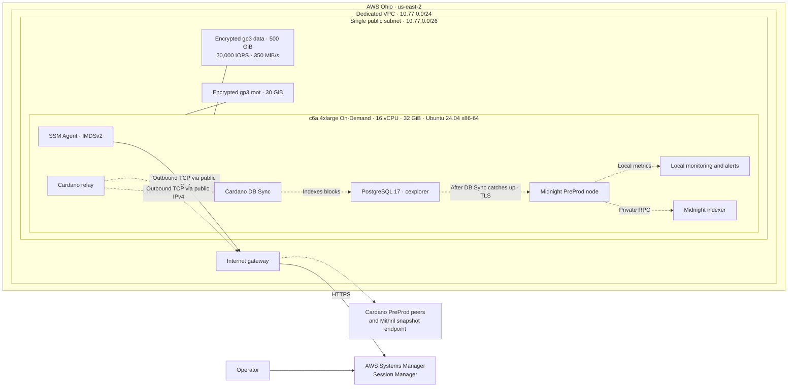

# Midnight PreProd EC2 review

This Terraform root defines the AWS host for the live take-home exercise. The dashed paths show service connections configured during the host bootstrap.



## Design choices for review

- **Placement.** Ohio is the default. Terraform selects the first enabled Availability Zone that offers the instance type unless `availability_zone` is set. AWS listed `c6a.4xlarge` in all three Ohio Availability Zones. An offering is a catalog listing. Launch capacity can vary.
- **Image.** Terraform looks up a current Canonical-owned Ubuntu 24.04 AMD64 gp3 AMI. Set `ami_id` to pin the image used for a subsequent plan.
- **Access.** The host uses an IAM instance profile for Session Manager. Its public IPv4 provides internet egress through the internet gateway. The security group allows outbound TCP and has zero inbound rules. Keep PostgreSQL, RPC, and monitoring local to the host. The restricted FNO WireGuard setup would need the Foundation's peer configuration and its own UDP rules.
- **Disk.** The data disk survives EC2 stop and start or instance replacement in the same Availability Zone. A Terraform destroy of this stack also deletes the managed volume. After deployment review, identify the blank NVMe disk by the Terraform `data_volume_id`, format it once, and persist the mount by filesystem UUID before writing any chain or database data.
- **Performance.** The instance has 8 x86 cores, 32 GiB RAM, and an AWS baseline of 20,000 EBS IOPS at 16 KiB operations. This configuration targets the FNO guide's 20,000 IOPS floor. The Cardano guide recommends 30,000 IOPS, so DB Sync may take longer with this setting.
- **Scope.** This deployed root uses local Terraform state. The runbook covers host configuration and chain sync. The [stack outline](../stack/README.md) covers the reusable model, with its own backend and CI.

## Deployment and Terraform review

On 16 November 2026, Terraform completed the Ohio On-Demand deployment in `us-east-2a`. The initial apply created the network before encountering an IAM denial. After the deployment permissions were updated, Terraform created the Session Manager role and profile, reused the existing network, and launched the approved instance once AWS EC2 regional verification cleared.

EC2 system, instance, and attached EBS checks passed. The encrypted 500 GiB gp3 volume is attached with 20,000 IOPS and 350 MiB/s. The signed-in AWS Console reported the Session Manager agent as **Online** and **Connected**. Use **EC2 → Instances → midnight-preprod → Connect → In web browser → SSM Session Manager** for admin access.

The post-deployment Terraform plan shows **no changes**. The instance uses Canonical AMI `ami-096d6538c463eb1db`. Use `terraform -chdir=infra/ec2 output instance_id` and `terraform -chdir=infra/ec2 output data_volume_id` to retrieve the live resource IDs.

The 16 November 2026 Ohio pricing estimate is **$9.68 for 12 hours** or **$19.35 for 24 hours**, including the instance at $0.612 per hour, both EBS volumes, and one public IPv4 address for that period. This excludes taxes, snapshots, and billable data transfer. EBS billing continues while the disks are retained. [Ohio price list](https://pricing.us-east-1.amazonaws.com/offers/v1.0/aws/AmazonEC2/current/us-east-2/index.csv) · [EBS pricing](https://aws.amazon.com/ebs/pricing/) · [IPv4 pricing](https://aws.amazon.com/vpc/pricing/)

Read the saved plan from the project root.

```bash
terraform -chdir=infra/ec2 show -no-color ohio.tfplan
```

Edit the defaults in [variables.tf](variables.tf), or pass your own values in a local `*.tfvars` file. Use AWS credentials supplied outside the Terraform configuration and check the selected AWS identity before planning.

```bash
terraform -chdir=infra/ec2 init
terraform -chdir=infra/ec2 fmt -check
terraform -chdir=infra/ec2 validate
terraform -chdir=infra/ec2 plan -out=ohio.tfplan
```

The plan shows the chosen Availability Zone and AMI. Treat `ohio.tfplan` and local state as local artifacts. The root `.gitignore` excludes them and the local AWS credentials file.

The [PreProd runbook](../../RUNBOOK.md) records the mounted data disk, Cardano relay, private PostgreSQL, DB Sync setup, and observed indexed block heights. Verify the database is tracking the live Cardano tip before starting Midnight.

[EC2 instance offerings](https://docs.aws.amazon.com/ec2/latest/instancetypes/ec2-instance-regions.html#us-east-2) · [EBS performance](https://docs.aws.amazon.com/AWSEC2/latest/UserGuide/ebs-optimized.html) · [FNO PreProd requirements](https://midnightfoundation.notion.site/FNO-Preprod-Requirements-3374057b9f2380a7b530d013ab20d276) · [Cardano hardware guidance](https://docs.midnight.network/nodes/cardano-node) · [Session Manager prerequisites](https://docs.aws.amazon.com/systems-manager/latest/userguide/session-manager-prerequisites.html) · [Cardano DB Sync setup](https://docs.midnight.network/nodes/cardano-db-sync)
